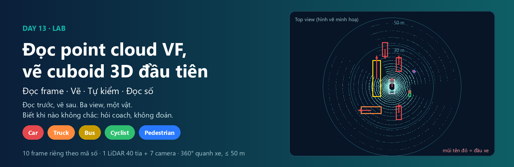
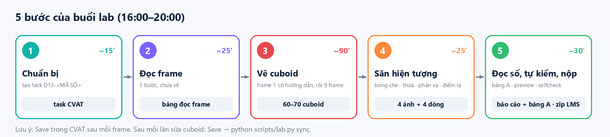
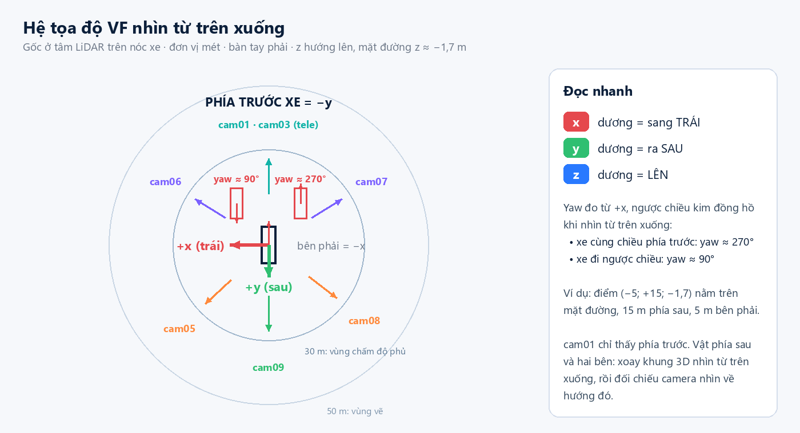

  

# Day 13 Lab — Đọc point cloud VF và vẽ cuboid 3D đầu tiên

  
  
  
  
  
  

> **Đọc trước, vẽ sau. Ba view, một vật.** Bạn vẽ 60–70 cuboid 3D trên point cloud thật, rồi **đọc lại bằng số** xem chính cuboid của mình có đúng hướng, chạm đường và hợp kích thước không.

Bạn nhận một task CVAT riêng gồm **10 frame LiDAR thật** của dữ liệu VF (1 LiDAR 40 tia + 7 camera), chọn cố định theo mã số của bạn.
Trong vùng 360° quanh xe, xa ≤ 50 m, mỗi frame có khoảng 18 vật: xe con, xe tải, xe buýt, xe hai bánh, người đi bộ. **Không ai vẽ hết**, nên bạn vẽ vật gần và rõ trước.
Việc của bạn là **đọc frame** theo năm bước, **vẽ cuboid** theo guideline 3D Cuboid, **săn bốn hiện tượng** làm hỏng point cloud, rồi **tự kiểm bằng số** từ bảng A và báo cáo trung thực.

Công cụ đã **viết sẵn** (`cvat_lab/`, `scripts/`): tạo task, xuất bảng A, chiếu cuboid lên ảnh camera, soát cuboid bằng point cloud. Bạn không viết code; bạn tập trung vào **đọc point cloud và vẽ cho đúng**.
Cuboid hôm nay là hình đơn lẻ trên từng frame, không phải track. Track và nội suy là nội dung Ngày 24–26.

## Bộ dữ liệu

**Dữ liệu VF**: dữ liệu lái xe thực tế của dự án, 5 sequence × 60 frame, cách nhau 1 giây. Mỗi frame có một point cloud (khoảng 63–68 nghìn điểm) và 7 ảnh camera 1920×1020. Mã số của bạn chọn ra **10 frame** (2 frame mỗi sequence, cách nhau ít nhất 15 giây), nên bài của mỗi người khác nhau. Dữ liệu **không nằm trong repo**: bạn tải riêng và giữ trên máy. Chi tiết: [data/README.md](data/README.md).

## Bắt đầu nhanh (5 bước, ~4 giờ)

1. Mở https://github.com/VinUni-AI20k/K5-L23-Day13-PointCloud-Cuboid-Lab → **Use this template** → repo **public** của bạn (tên: xem [SUBMISSION.md](SUBMISSION.md)), `git clone`, cài môi trường và tải dữ liệu **trước buổi học** ([docs/SETUP.md](docs/SETUP.md), [docs/CVAT_SETUP.md](docs/CVAT_SETUP.md)). Điền `configs/lab.ini`, rồi `python scripts/lab.py dry` in ra **10 frame, mỗi frame `camera=7`**.
2. `python scripts/lab.py task` tạo task `D13-<MÃ SỐ>`. **Đọc frame** theo năm bước trên 2 frame đầu, chưa vẽ ([GUIDE.md](GUIDE.md)).
3. **Vẽ cuboid**: frame 1 có hướng dẫn (từ 8, nên 10), chín frame sau mỗi frame từ 5 (nên 6). Tra [docs/GUIDELINE.md](docs/GUIDELINE.md).
4. **Săn bốn hiện tượng** làm hỏng point cloud: bóng che, thưa ở xa, phản xạ thấp, điểm lạ ([docs/PHENOMENA.md](docs/PHENOMENA.md)).
5. `python scripts/lab.py sync` (bảng A + ảnh xem trước + phiếu tự kiểm), sửa cuboid, viết `submission/REPORT.md`, `python scripts/check_submission.py` hết LỖI → nộp.

> **Khi nộp:** đổi dòng tiêu đề README thành `# Day 13 Lab — <Họ và tên>: <MSHV> - <Họ và tên>`.
> Mọi lệnh `python scripts/lab.py ...` chạy **giống nhau trên Windows và macOS**. macOS có thêm lệnh tắt `make` ([Makefile](Makefile)). Lệnh riêng từng hệ điều hành (cài đặt, kích hoạt môi trường, mở file): [docs/COMMANDS.md](docs/COMMANDS.md).

<b>Vì sao tối thiểu 8/5 mà lại khuyên vẽ 10/6?</b>

Độ phủ chấm trên vật trong 30 m, khoảng 9 vật mỗi frame. Cuboid lệch quá nửa diện tích so với vật thì không được tính. Vẽ đúng mức tối thiểu 8/5 và vẽ chính xác thì độ phủ chỉ quanh 0,45–0,5, sát ngưỡng đạt 0,4. Vẽ 10/6 cho bạn khoảng dư để vài cuboid lệch không làm trượt. Xem [RUBRIC.md](RUBRIC.md).

<b>Máy yếu / không chạy được Docker / CVAT không chiếu cuboid lên ảnh?</b>

- Máy 8 GB RAM: dùng `cvat/docker-compose.lowspec.yml` ([docs/CVAT_SETUP.md](docs/CVAT_SETUP.md) mục 6).
- Không chạy nổi Docker: báo coach để ngồi ghép đôi. Mỗi người vẫn một tài khoản CVAT và một task riêng.
- CVAT bản thường có thể không chiếu cuboid lên ảnh camera ("biểu tượng vàng" trong guideline). Dùng `python scripts/lab.py preview` để xem cuboid của bạn trên 7 ảnh camera.
- Không có chuột: vẽ cuboid 3D bằng touchpad rất chậm. Mang chuột có con lăn.

## Bạn sẽ có gì sau bài này

| Sản phẩm | Ở đâu |
|---|---|
| Task CVAT `D13-<MÃ SỐ>` với 60–70 cuboid đã Save | CVAT của bạn |
| **Bảng A**: 7 tham số, khoảng cách, đáy cuboid của từng cuboid | `submission/D13-<MÃ SỐ>-bangA.csv` |
| **Phiếu tự kiểm**: số điểm trong cuboid, khoảng hở với mặt đường, cảnh báo | `submission/D13-<MÃ SỐ>-tukiem.csv` |
| 11 ảnh chụp màn hình (đọc frame, cuboid mẫu, bốn hiện tượng) | `submission/images/` (nộp LMS, không commit) |
| **Một báo cáo duy nhất**: đọc frame, cuboid mẫu, bốn hiện tượng, số đo, điều còn chưa chắc | `submission/REPORT.md` |

## Tài liệu

| Bạn cần | Xem |
|---|---|
| Các bước làm việc, lệnh, mốc giờ | [GUIDE.md](GUIDE.md), [CHECKPOINTS.md](CHECKPOINTS.md) |
| Quy tắc, giữ dữ liệu trong lớp, dùng AI | [RULES.md](RULES.md) |
| Chấm điểm | [RUBRIC.md](RUBRIC.md) |
| Nộp bài | [SUBMISSION.md](SUBMISSION.md) |
| Dữ liệu VF: tải, cấu trúc, giấy phép | [data/README.md](data/README.md) |
| Cài Git, Python, thư viện (Windows và macOS) | [docs/SETUP.md](docs/SETUP.md) |
| Cài CVAT trên máy, máy yếu, mẹo giao diện 3D | [docs/CVAT_SETUP.md](docs/CVAT_SETUP.md) |
| **Mọi lệnh của buổi lab**, Windows và macOS | [docs/COMMANDS.md](docs/COMMANDS.md) |
| Hệ tọa độ VF, 7 tham số, hướng 7 camera | [docs/COORDINATES.md](docs/COORDINATES.md) |
| Tóm tắt guideline: 5 class, quy tắc cuboid, bảng 4.3 | [docs/GUIDELINE.md](docs/GUIDELINE.md), [bản đầy đủ (.docx)](docs/3D_Cuboid_Annotation_Guideline.docx) |
| Bốn hiện tượng làm hỏng point cloud, frame gợi ý | [docs/PHENOMENA.md](docs/PHENOMENA.md) |
| Đọc `preview`, cờ của `selfcheck`, cột của bảng A | [docs/SELF_CHECK.md](docs/SELF_CHECK.md) |
| Lỗi hay gặp và cách tự gỡ | [docs/COMMON_ERRORS.md](docs/COMMON_ERRORS.md) |
| Label cuboid cho CVAT | [cvat/labels.json](cvat/labels.json) |

Slide tham khảo: **Day 13 — LiDAR, point cloud và nhãn 3D**. Buổi sau: Ngày 24–26 (gán nhãn chính thức theo track).

## Bạn học được gì

- **Đọc** một frame LiDAR: gốc và trục (x trái, y sau, z lên), mặt đất, tầm nhìn, và cái gì chỉ camera hay chỉ LiDAR cho biết.
- **Vẽ** cuboid 7 tham số đúng class, mũi tên chỉ đầu xe, đáy chạm đường, khớp ở cả Top, Side, Front.
- **Nhận ra** chỗ point cloud không đáng tin (bóng che, thưa ở xa, phản xạ thấp, điểm lạ) và biết khi nào **không đoán**.
- **Kiểm bằng số**: đọc bảng A, so với bảng kích thước, và báo cáo trung thực cả những cuboid còn chưa chắc.

Hình trong `docs/assets/` là hình vẽ minh hoạ do lab coach tạo bằng `docs/assets/make_figures.py`, không chứa dữ liệu VF.
