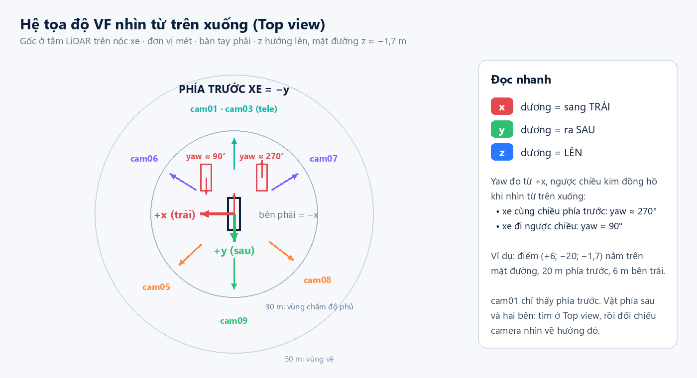

# Hệ tọa độ VF, cuboid 7 tham số, camera

## 1. Hệ tọa độ VF

Gốc ở tâm LiDAR trên nóc xe, đơn vị mét, bàn tay phải.

| Trục | Chiều dương | Ghi nhớ |
|---|---|---|
| x | sang **trái** | bên phải xe là −x |
| y | ra **sau** | phía trước xe là **−y** |
| z | **lên** | mặt đường khoảng z = −1,7 m (LiDAR cao khoảng 1,7 m) |

Ví dụ: điểm (x, y, z) = (+6, −20, −1,7) nằm trên mặt đường, 20 m phía trước và 6 m bên trái.

Hệ này khác KITTI và ROS (x tiến, y trái). Nếu bạn đã quen hệ khác, kiểm lại bằng ảnh cam01: cam01 nhìn về phía trước xe, tức hướng −y.

## 2. Cuboid 7 tham số

`(cx, cy, cz, l, w, h, yaw)`: tâm cuboid; dài (dọc theo hướng yaw), rộng, cao; yaw quanh trục z, đo từ +x (trái), ngược chiều kim đồng hồ nhìn từ trên.

- Xe cùng chiều phía trước: yaw ≈ **270°**.
- Xe đi ngược chiều: yaw ≈ **90°**.

## 3. Camera

| Camera | Nhìn về |
|---|---|
| cam01, cam03 | phía trước (cam03 là ống tele) |
| cam06 | trước-trái |
| cam07 | trước-phải |
| cam05 | sau-trái |
| cam08 | sau-phải |
| cam09 | phía sau |

LiDAR phủ 360°, mỗi camera chỉ phủ một hình quạt. **Vật phía sau và hai bên không có trong ảnh cam01**: tìm chúng ở view Top rồi đối chiếu camera nhìn về hướng đó.
